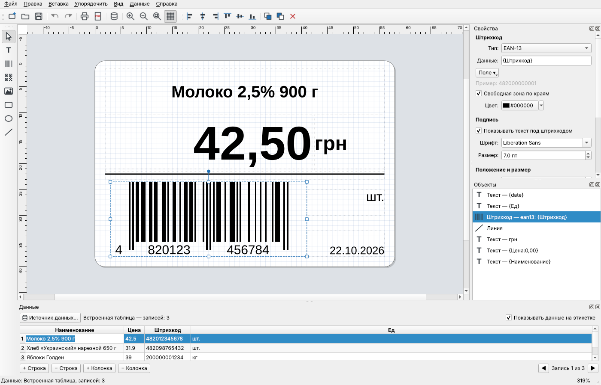
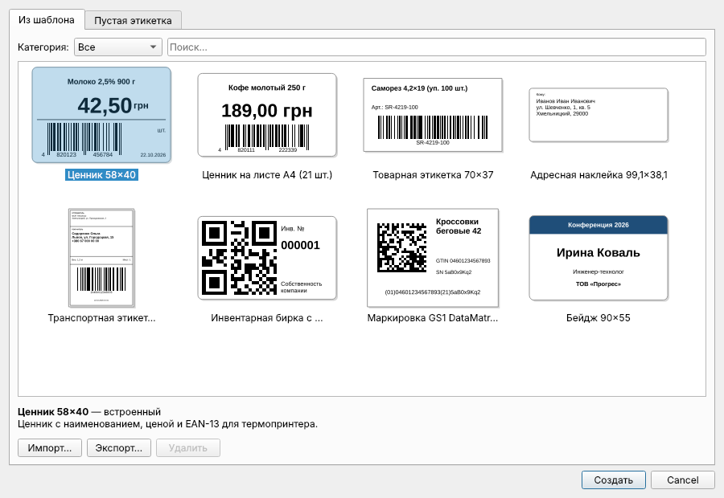
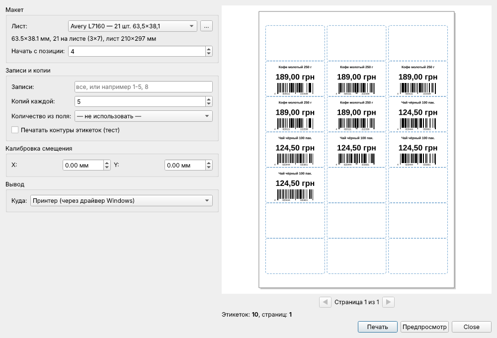

# LabelForge

Свободная программа для дизайна и печати этикеток, ценников, адресных наклеек, бейджей и штрихкодов. Написана на C++17 / Qt 6, компилируется в обычный `LabelForge.exe` для Windows (работает и в Linux).

Лицензия — **GNU GPL v3 или новее**.



## Возможности

**Редактор этикеток**
- Объекты: текст, штрихкод, QR / Data Matrix, изображение, прямоугольник (со скруглением), эллипс, линия.
- Перемещение мышью, восемь маркеров изменения размера (Shift — с сохранением пропорций), поворот за круглый маркер (шаг 15°, с Shift — 1°).
- Сетка и привязка, линейки в миллиметрах, масштаб Ctrl+колесо, шаг сетки выбирается на панели (от 0,1 мм или любое своё значение), Alt при перетаскивании — без привязки, сдвиг стрелками на 0,1 мм (Shift — 1 мм).
- Выравнивание, распределение, порядок слоёв, копирование/вставка/дублирование, неограниченная отмена.
- Текст: любой шрифт, начертания, цвет и заливка, выравнивание по горизонтали и вертикали, перенос по словам, **автоуменьшение**, чтобы текст поместился в рамку.
- Объекты, которые не надо печатать (подложки, подсказки), отмечаются флажком.

**Штрихкоды** (собственная реализация, проверена независимым сканером zxing-cpp)
- Code 128, GS1-128 (EAN-128), EAN-13, EAN-8, UPC-A, Code 39, Interleaved 2 of 5, ITF-14;
- QR Code (уровни коррекции L/M/Q/H), Data Matrix ECC 200, **GS1 DataMatrix** (маркировка).
- Контрольные цифры EAN/UPC/ITF-14 считаются автоматически; GS1 вводится как `(01)04601234567893(21)ABC`.
- На термопринтерах ширина модуля подгоняется под целое число точек — штрихкоды читаются надёжно.

**Данные и переменные**
- Источники: встроенная таблица (хранится в файле этикетки), CSV/TXT (автоопределение разделителя и кодировки UTF-8/Windows-1251), **Excel .xlsx** (без установленного Excel), базы данных через **ODBC** (SQL Server, MySQL, Access, PostgreSQL и т. д.).
- Поля в тексте, штрихкодах и путях к картинкам: `{Наименование}`, форматирование `{Цена:0,00}`, `{Код:000000}`, `{Имя:upper}`.
- Счётчики `{seq}`, `{seq:0001}`, `{seq:100:10}`, номер записи `{rec}`, дата `{date}`, `{date+30:dd.MM.yy}` (срок годности), время `{time}`.
- Количество этикеток на запись — из поля таблицы; выбор записей диапазоном `1-5, 8`.
- Картинка из файла по шаблону пути: `photos\{Артикул}.jpg`.

**Печать**
- Листы A4/Letter: встроенные шаблоны Avery/Zweckform (L7160, L7163, L7651 и др.) и типовые A4-листы; **свой шаблон листа** в редакторе с предпросмотром.
- **Несколько мелких этикеток на одной большой рулонной** (например, 9 наклеек 30×20 на этикетке 100×70) и «сколько поместится» на A4 — раскладка считается автоматически по размеру этикетки; в редакторе листов есть кнопка «Разложить автоматически» для любого размера бумаги. Работает и при прямой печати ZPL/TSPL.
- Начало с любой позиции частично использованного листа, калибровка смещения, печать контуров для проверки.
- Рулоны и термопринтеры через драйвер Windows или **напрямую командами ZPL II** (Zebra и совместимые) и **TSPL** (TSC, Xprinter, Gprinter, HPRT…), 203/300/600 dpi. Одинаковые этикетки подряд объединяются в одну команду с количеством.
- Экспорт в PDF (векторный), PNG и файлы команд .zpl/.prn.

**Шаблоны**
- 8 встроенных шаблонов этикеток (ценники, товарная этикетка, адресная наклейка, транспортная 100×150, инвентарная бирка с QR, GS1 DataMatrix, бейдж).
- «Файл → Сохранить как шаблон»: свои шаблоны с категориями и описанием; импорт/экспорт, удаление.
- Шаблоны листов и рулонов: создание, дублирование встроенных, сохранение, удаление.

**Пакетный режим** — печать из учётной системы или скрипта без открытия окна (см. ниже).

| Новая этикетка из шаблона | Печать на лист A4 |
|---|---|
|  |  |

## Сборка под Windows

Нужны: **Qt 6.4+** (рекомендуется 6.8 LTS) (компоненты *MSVC 2022 64-bit*; модули Core, Gui, Widgets, PrintSupport, Sql входят в базовую поставку), **Visual Studio 2022** (или Build Tools) и **CMake 3.21+**.

Вариант 1 — Qt Creator: «Файл → Открыть файл или проект» → `CMakeLists.txt` → выбрать комплект *Desktop Qt 6.x MSVC2022 64bit* → Собрать.

Вариант 2 — командная строка (*x64 Native Tools Command Prompt for VS 2022*):

```bat
set QTDIR=C:\Qt\6.8.3\msvc2022_64
build-windows.bat
```

Скрипт соберёт проект и выполнит `windeployqt`; готовая программа — в `dist\LabelForge\`, её можно копировать на любой компьютер с Windows 10/11 x64.

Вручную:

```bat
cmake -S . -B build -G "NMake Makefiles" -DCMAKE_BUILD_TYPE=Release -DCMAKE_PREFIX_PATH=C:\Qt\6.8.3\msvc2022_64
cmake --build build
windeployqt --release --compiler-runtime build\LabelForge.exe
```

Установщик: после `build-windows.bat` выполните `iscc packaging\windows\labelforge.iss` (Inno Setup 6) — получится `dist\LabelForge-1.0.0-setup.exe` с ярлыками и ассоциацией файлов `.lfl`.

**GitHub Actions**: workflow `.github/workflows/build.yml` собирает Windows-версию (zip + установщик) на каждый push и прикрепляет её к релизу при теге `v*`; заодно прогоняет тесты на Linux.

Linux: `sudo apt install qt6-base-dev cmake g++`, затем `cmake -S . -B build && cmake --build build`.

## Работа с программой

1. **Файл → Новая этикетка**: шаблон или пустая этикетка (размер вручную или по шаблону листа).
2. Инструменты слева (горячие клавиши на холсте: V — выбор, T — текст, B — штрихкод, Q — QR, I — изображение, R, E, L — фигуры) — щелчок по этикетке добавляет объект.
3. Свойства выбранного объекта — справа; без выделения там параметры самой этикетки и макет печати.
4. **Данные → Источник данных**: подключите CSV, Excel или базу; кнопка «Поле ▾» вставляет поля в текст и штрихкод. Нижняя панель показывает записи; выбор строки меняет предпросмотр.
5. **Файл → Печать** (Ctrl+P): лист или рулон, записи и копии, вывод на принтер, PDF, термопринтер или в файл.

Полный список переменных — **Справка → Переменные и поля** (F1).

### Термопринтеры

- Через драйвер Windows: выберите «Рулон / термопринтер» и принтер в системном диалоге — размер страницы равен размеру этикетки.
- Напрямую (RAW): «Вывод → Термопринтер напрямую», язык ZPL или TSPL, разрешение принтера (обычно 203 dpi). Если TSPL-принтер печатает негатив, переключите «Инвертировать растр».

## Пакетный режим

```bat
LabelForge.exe ценники.lfl --pdf ценники.pdf
LabelForge.exe ценники.lfl --data goods.xlsx --sheet "Прайс" --layout avery-l7160 --print default
LabelForge.exe ценники.lfl --data export.csv --raw "ZDesigner GK420d" --lang zpl
LabelForge.exe бирка.lfl --copies 50 --zpl birki.zpl
```

| Параметр | Назначение |
|---|---|
| `--pdf файл` / `--png шаблон_%1.png` | экспорт в PDF / PNG по этикетке |
| `--zpl файл` / `--tspl файл` | файл команд термопринтера |
| `--raw принтер` `--lang zpl\|tspl` | отправка команд прямо в очередь принтера |
| `--print принтер` | печать через драйвер (`default` — принтер по умолчанию) |
| `--data файл` `--sheet лист` | подменить источник данных (CSV или XLSX) |
| `--layout id` `--copies N` `--records 1-10` `--dpi 203` | параметры задания |

Код возврата 0 — успех; ошибки пишутся в stderr.

## Формат файла `.lfl`

Обычный JSON в UTF-8: размеры этикетки (мм), список объектов, источник данных и параметры печати. Его удобно хранить в git и генерировать скриптами. Пример — `examples/price_tags.lfl` (ценники из `price_tags.csv`, количество берётся из колонки «Количество»).

Пользовательские шаблоны лежат в `%APPDATA%\LabelForge\LabelForge\templates`, шаблоны листов — в `...\sheets`.

## Структура исходников

```
src/core        модель документа, переменные, раскладка текста, отрисовка
src/barcode     кодировщики штрихкодов (Code128/GS1-128, EAN/UPC, Code39, ITF, Data Matrix; QR — через qrcodegen)
src/data        CSV, XLSX (собственный ZIP/DEFLATE-распаковщик), ODBC
src/print       шаблоны листов, раскладка задания, PDF/принтер, ZPL/TSPL, RAW-печать
src/templates   библиотека шаблонов этикеток
src/ui          интерфейс (Qt Widgets)
tests           самотест ядра, UI-тест, проверка штрихкодов сканером zxing-cpp
```

## Тесты

```bash
cmake -S . -B build && cmake --build build
python3 tests/make_test_xlsx.py build/test.xlsx
QT_QPA_PLATFORM=offscreen ./build/labelforge_selftest build/out build/test.xlsx
python3 tests/verify_barcodes.py build/out      # pip install zxing-cpp pillow
QT_QPA_PLATFORM=offscreen ./build/labelforge_uitest build/ui
```

## Лицензия и сторонний код

- LabelForge — GNU GPL v3 или новее (`LICENSE`).
- `third_party/qrcodegen` — QR Code generator library, © Project Nayuki, лицензия MIT.
- Qt 6 — LGPL v3 (динамическая компоновка, библиотеки поставляются рядом с exe).
